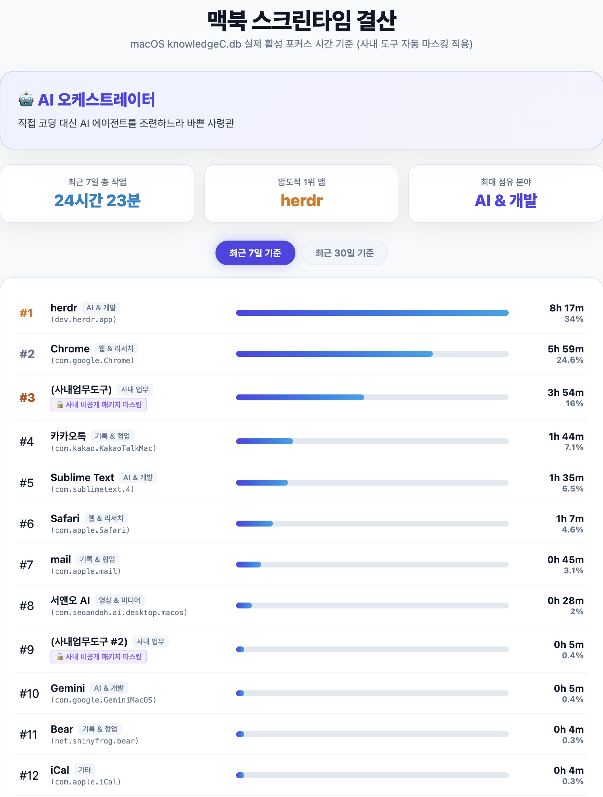
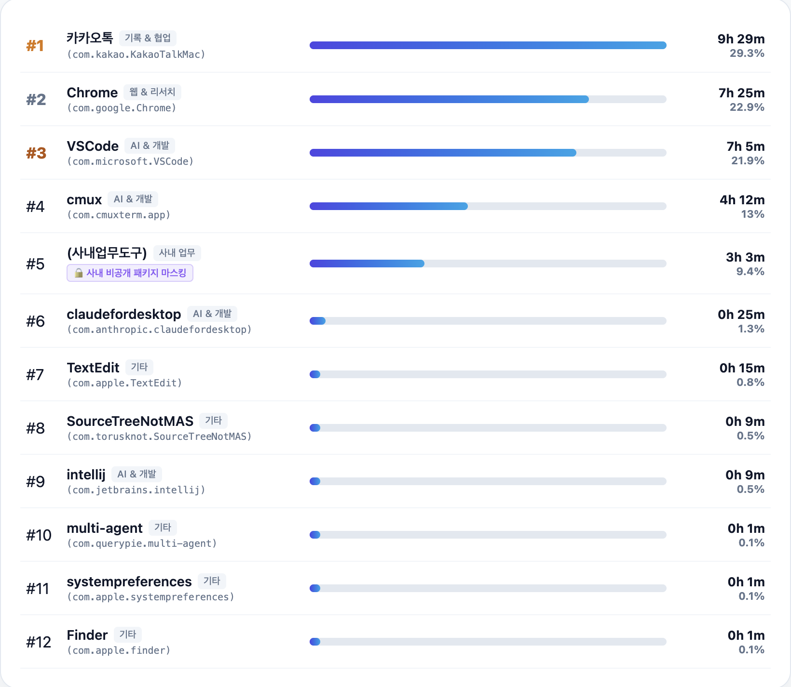
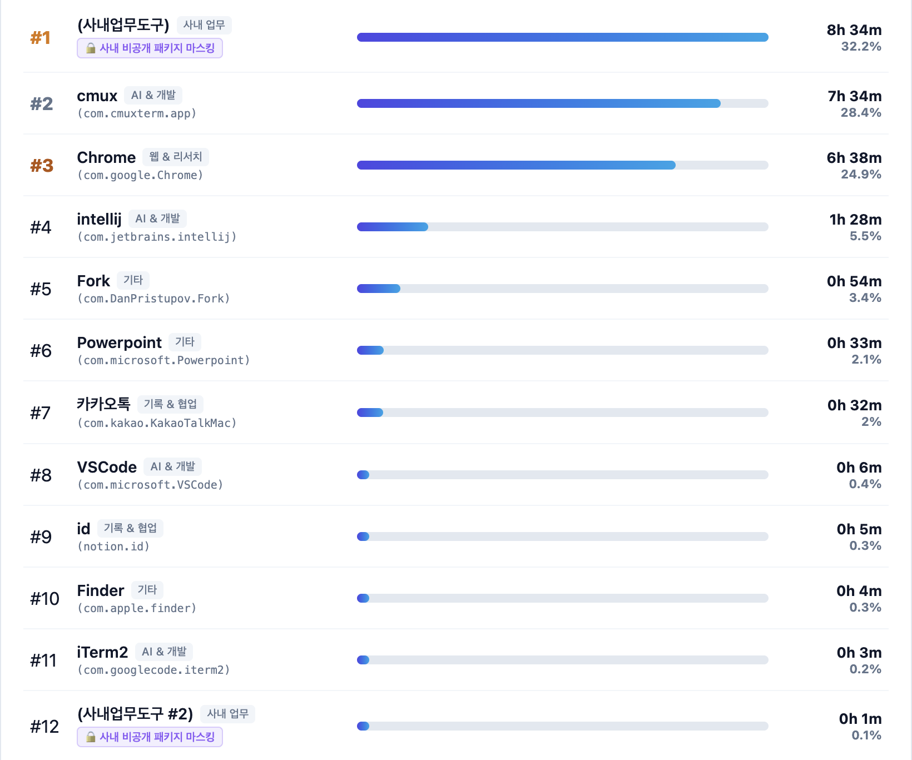

  <a href="https://youtu.be/El5DKRb2h7U" target="_blank" rel="noopener noreferrer" style="font-weight: 600; display: inline-flex; align-items: center; gap: 8px; color: #e62117; text-decoration: none;">
    <svg viewBox="0 0 24 24" width="20" height="20" fill="currentColor" style="flex-shrink: 0;"><path d="M23.498 6.163a3.003 3.003 0 0 0-2.11-2.11C19.517 3.545 12 3.545 12 3.545s-7.517 0-9.388.508a3.003 3.003 0 0 0-2.11 2.11C0 8.033 0 12 0 12s0 3.967.502 5.837a3.003 3.003 0 0 0 2.11 2.11c1.871.508 9.388.508 9.388.508s7.517 0 9.388-.508a3.003 3.003 0 0 0 2.11-2.11C24 15.967 24 12 24 12s0-3.967-.502-5.837zM9.545 15.568V8.432L15.818 12l-6.273 3.568z"/></svg>
    ▶ 원본 영상 보기: “진짜 IDE 안 써요?” 댓글 보고 판뚜네 개발팀 스크린타임 까봤습니다
  </a>

## 1. "진짜 IDE 안 써요?" 댓글 하나에서 시작된 의문

얼마 전 올렸던 영상의 댓글창을 둘러보다가, 유독 뼈를 때리는 댓글 하나가 눈에 밟혔습니다.

1년 정도 쉬다가 다시 복귀를 준비하시는 개발자분의 솔직한 질문이었습니다. 
"요즘 정말 코딩을 거의 안 하냐", "IDE를 안 켠다면 유지보수를 아예 안 하는 거냐"는 물음이었죠.

협찬이나 과장 없이, 진짜 요즘 저희 팀이 어떻게 일하길래 코딩 에디터를 안 켠다고 말하는 건지 궁금해하시는 분들이 많았습니다. 백 마디 설명보다 눈으로 보여드리는 게 빠를 것 같아서, 제 업무용 맥북의 실제 사용 데이터부터 까보기로 했습니다.

---

## 2. 판교 14년차 개발자의 맥북 스크린타임 1위는?

맥OS에는 백그라운드에서 어떤 앱을 얼마나 활성화해서 썼는지 기록해두는 시스템 데이터베이스(`knowledgeC.db`)가 있습니다. 여기서 최근 일주일 치 데이터를 뽑아 웹 화면으로 그려봤습니다. (사내 보안 툴과 인하우스 메신저는 가렸습니다.)

*(※ 주말이 포함된 최근 7일치 집계라 총 활성 작업 시간이 평소보다 적게 찍혀 있는 점 감안해서 봐주세요!)*

스크린타임을 열자마자 나온 결과는 이렇습니다. (최근 7일 총 작업 24시간 23분)

* **압도적 1위:** `herdr` (8시간 17분, 34%)
* **2위:** `Chrome` (5시간 59분, 24.6% - 웹 & 리서치)
* **3위:** `(사내업무도구)` (3시간 54분, 16%)
* **4위:** `카카오톡` (1시간 44분, 7.1%)
* **5위:** `Sublime Text` (1시간 35분, 6.5%)
* **그 외:** `Safari`, `Mail`, `서앤오 AI`, `Gemini`, `Bear` 등

놀랍게도 **VSCode나 IntelliJ 같은 정통 IDE는 순위권에 그림자도 없었습니다.**

제가 JetBrains랑 친하고 협업 영상도 찍었지만, 솔직히 고백하자면 요즘 업무하면서 IDE를 거의 띄우지 않습니다. 개발 도구라고 화면에 떠 있는 건 오직 **`herdr`** 하나뿐이고, 나머지는 전부 메신저나 브라우저 같은 협업 툴입니다.

---

## 3. 왜 herdr인가: 1년 만에 뒤바뀐 AI 코딩의 형태

불과 1년 전, Claude Code CLI가 처음 등장했을 때만 해도 이렇지 않았습니다. 

그때는 터미널 단일 세션 하나 띄워두고 가끔 질문 던지거나 리팩토링 힌트 얻는 '보조 바퀴' 느낌이었거든요. 그냥 기본 터미널이나 에디터 내장 터미널 하나로도 충분히 커버가 됐습니다.

그런데 1년 만에 작업 방식이 완전히 바뀌었습니다.

1. **단일 태스크의 병렬화:** 이제는 일 하나를 해도 여러 세션으로 쪼개서 에이전트 서너 명에게 동시에 던집니다.
2. **세션 간 결과 취합:** 각 에이전트가 브랜치 따서 작업해 온 결과물을 모아서 검토하고, diff를 확인하고 배포해야 합니다.
3. **영속성(Persistence)의 필요:** 에이전트가 백로그를 처리하는 동안 창을 닫거나 컴퓨터를 이동해도 작업이 죽으면 안 됩니다.

이걸 감당하려면 터미널 세션들을 제대로 오케스트레이션해 주는 관리 도구가 필수적인데요. 저는 **`herdr`**를 씁니다.

`herdr`의 가장 큰 장점은 아키텍처에 있습니다. 백그라운드에 **`herdr-core`라는 로컬 서버(데몬)**가 상시 떠서 세션들을 쥐고 있고, 데스크톱 앱은 거기에 연결해서 화면만 보여주는 클라이언트 역할을 합니다. 

즉, 실수로 데스크톱 창을 꺼버려도 `herdr-core` 프로세스를 직접 kill하지 않는 이상, 안에서 돌아가던 AI 에이전트 세션들이 절대 죽지 않고 살아있습니다.

---

## 4. 팀원 맥북 기습 점검: "너네도 코딩 에디터 안 켜?"

"나 혼자만 유난 떨며 특이하게 일하는 건 아닐까?" 싶어서 점심시간에 같은 팀 동료들의 맥북을 기습해서 무슨 앱을 많이 쓰나 살펴봤습니다.

### ① 동료 J

* **주 사용 앱:** 카카오톡(1위), Chrome(2위), 그리고 **`VSCode`**(3위, 7시간 5분) & **`cmux`**(4위, 4시간 12분)
* **IDE 사용 형태:** 켜두긴 함.
* **이유:** *"VSCode를 켜놓긴 하는데요, 솔직히 에디터 기능보단 그 안에 내장 터미널을 열어서 `cmux`로 일해요. 가끔 스크립트 짤 때나 코드 볼 때 말고는 손으로 직접 코딩 안 칩니다."*

 

### ② 동료 Z

* **주 사용 앱:** (사내업무도구)(1위), 그리고 **`cmux`**(2위, 7시간 34분), **`IntelliJ`**(4위, 1시간 28분)
* **IDE 사용 형태:** 켜져 있긴 함 (IntelliJ 1시간 28분, VSCode 6분).
* **이유:** *"코드를 아직 완전히 안 볼 수는 없어서 띄워는 둡니다. 근데 진짜 '뷰어(Viewer)' 용도로 눈으로 확인만 하고요. 실제 로직 수정이나 Git 작업은 전부 터미널에서 에이전트로 끝냅니다."*

 

결국 팀원들조차 정통 IDE는 **'코드 확인용 뷰어'**로만 띄워둘 뿐, 실제 작업의 90%는 `cmux`나 `herdr` 같은 터미널 워크스페이스에 완전히 대동단결되어 있었습니다.

---

## 5. 마치며: 그래서 정말 IDE는 구시대 유물이 되었을까

다시 처음에 받았던 질문으로 돌아가 봅니다.

> *"진짜 요즘 IDE 안 쓰나요? 코딩 안 하나요?"*

제 답변은 **"씁니다. 하지만 목적이 180도 바뀌었습니다"**에 가깝습니다.

예전의 IDE가 **'내가 직접 키보드로 코드를 한 땀 한 땀 생산하는 공장'**이었다면, 지금의 IDE는 **'AI 에이전트들이 짜온 코드를 감독관처럼 빠르게 검토하고 diff를 확인하는 뷰어'**가 되었습니다.

생산의 주체가 내가 아니라 에이전트로 넘어가다 보니, 자연스럽게 스크린타임 1위 자리도 에디터가 아니라 **여러 에이전트를 동시에 지휘하고 관리할 수 있는 터미널 워크스페이스(`herdr`, `cmux`)**가 차지하게 된 것이죠.

불과 1~2년 사이에 판교 현업 개발자들의 맥북 풍경이 이렇게까지 달라졌습니다. 앞으로 또 1년 뒤에는 우리 스크린타임에 어떤 앱이 1위를 차지하고 있을지, 기대 반 두려움 반으로 지켜보게 됩니다.

---

## 🎬 원본 영상 보기

팀원들과 회의실에서 나눈 대화와 실제 맥북 스크린타임 화면은 아래 유튜브 영상에서 직접 확인하실 수 있습니다!

  <iframe src="https://www.youtube.com/embed/El5DKRb2h7U" title="YouTube video player" frameborder="0" allow="accelerometer; autoplay; clipboard-write; encrypted-media; gyroscope; picture-in-picture; web-share" referrerpolicy="strict-origin-when-cross-origin" allowfullscreen style="position: absolute; top: 0; left: 0; width: 100%; height: 100%; border: none;"></iframe>

  <a href="https://youtu.be/El5DKRb2h7U" target="_blank" rel="noopener noreferrer" style="font-weight: 600; display: inline-flex; align-items: center; gap: 8px; color: #e62117; text-decoration: none;">
    <svg viewBox="0 0 24 24" width="20" height="20" fill="currentColor" style="flex-shrink: 0;"><path d="M23.498 6.163a3.003 3.003 0 0 0-2.11-2.11C19.517 3.545 12 3.545 12 3.545s-7.517 0-9.388.508a3.003 3.003 0 0 0-2.11 2.11C0 8.033 0 12 0 12s0 3.967.502 5.837a3.003 3.003 0 0 0 2.11 2.11c1.871.508 9.388.508 9.388.508s7.517 0 9.388-.508a3.003 3.003 0 0 0 2.11-2.11C24 15.967 24 12 24 12s0-3.967-.502-5.837zM9.545 15.568V8.432L15.818 12l-6.273 3.568z"/></svg>
    YouTube에서 영상으로 보기: “진짜 IDE 안 써요?” 댓글 보고 판뚜네 개발팀 스크린타임 까봤습니다
  </a>

