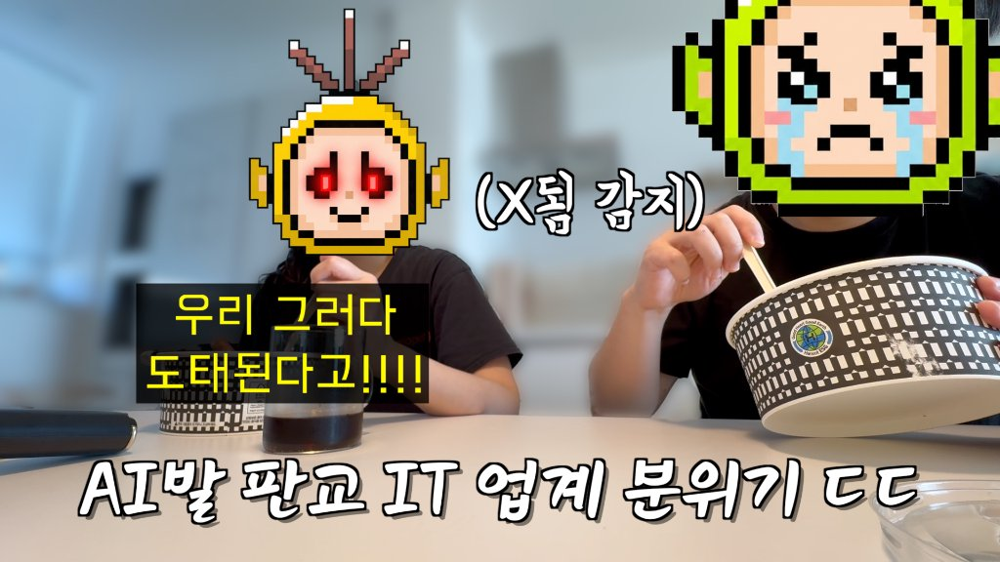
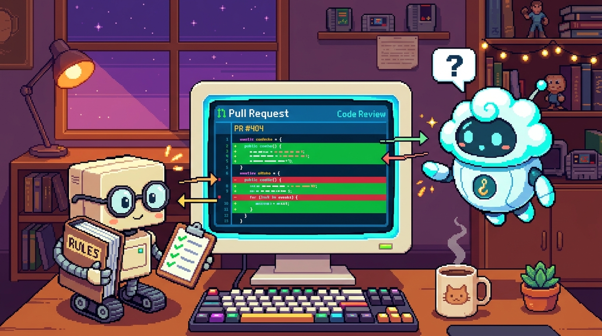
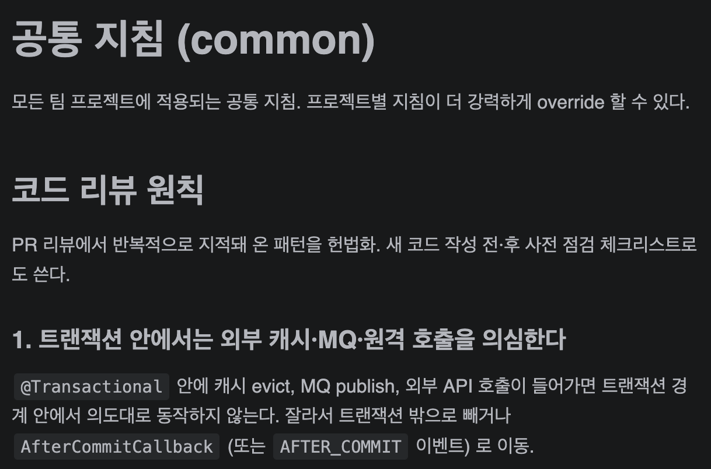
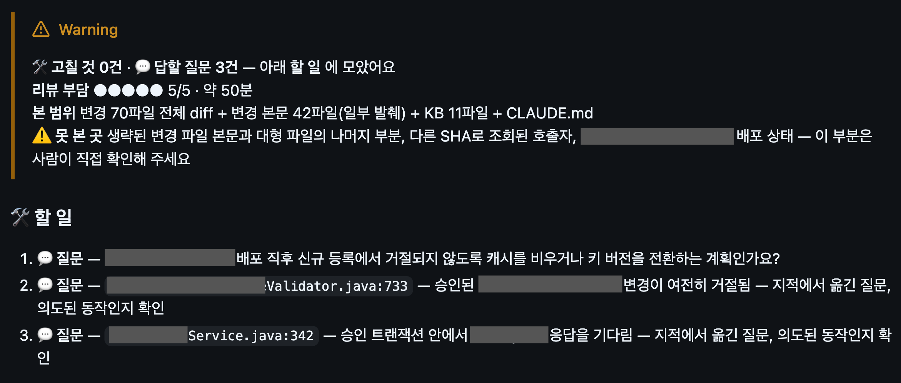
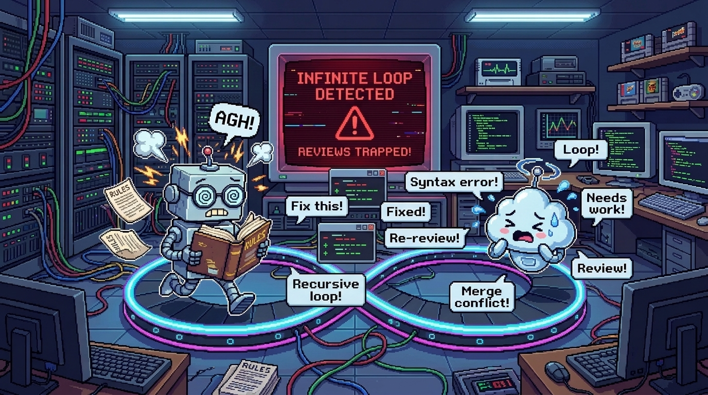
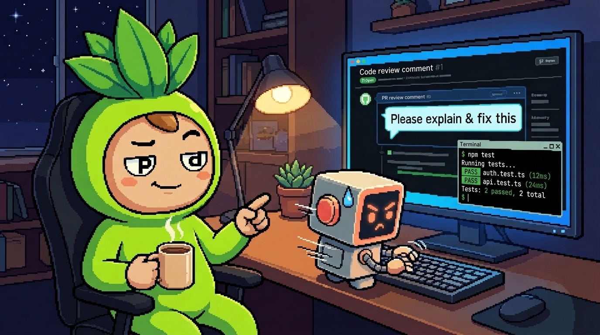

  <a href="https://youtu.be/2-CvcwEVhRQ" target="_blank" rel="noopener noreferrer" style="font-weight: 600; display: inline-flex; align-items: center; gap: 8px; color: #e62117; text-decoration: none;">
    <svg viewBox="0 0 24 24" width="20" height="20" fill="currentColor" style="flex-shrink: 0;"><path d="M23.498 6.163a3.003 3.003 0 0 0-2.11-2.11C19.517 3.545 12 3.545 12 3.545s-7.517 0-9.388.508a3.003 3.003 0 0 0-2.11 2.11C0 8.033 0 12 0 12s0 3.967.502 5.837a3.003 3.003 0 0 0 2.11 2.11c1.871.508 9.388.508 9.388.508s7.517 0 9.388-.508a3.003 3.003 0 0 0 2.11-2.11C24 15.967 24 12 24 12s0-3.967-.502-5.837zM9.545 15.568V8.432L15.818 12l-6.273 3.568z"/></svg>
    ▶ 원본 영상 보기: 코드.. 이제 사람이 못 봐요.. AI 정착 후 생존 경쟁이 되어버린 판교 IT 회사 분위기
  </a>

## 1. "AI가 코드를 너무 많이 찍어내서 다 볼 수가 없어요"

최근 올린 영상들의 댓글창을 보면 유독 눈에 자주 띄는 반응이 하나 있었습니다.

> *"AI 에이전트가 코드를 미친 듯이 찍어내니까, PR에 올라오는 코드량이 너무 많아서 사람이 도저히 다 볼 수가 없습니다. 이거 다들 어떻게 감당하고 계신가요?"*

질문이기도 하고, 하소연이기도 하고, 현업 개발자라면 누구나 가슴 깊이 공감할 만한 현실적인 비명이었죠.

실제로 요즘 Claude Code나 터미널 에이전트를 조금만 능숙하게 다루기 시작하면, 예전엔 며칠씩 걸리던 기능 개발이나 리팩토링이 몇 시간, 빠르면 수십 분 만에 뚝딱 끝나버립니다. 문제는 그 결과물로 수백, 수천 줄짜리 PR diff가 매일 수없이 쏟아진다는 겁니다.

그걸 사람이 모니터 앞에 앉아서 한 줄 한 줄 눈으로 뜯어보고 있다? 솔직히 눈도 빠지고, 멘탈도 터지고, 무엇보다 생산성 자체가 꽉 막히게 됩니다.

그렇다면 진짜 AI로 일하는 개발팀들은 이 쏟아지는 코드 폭탄을 어떻게 소화하고 있을까요?

---

## 2. 저희 팀의 결론: "사람이 코드 리뷰 안 합니다"

저희 팀은 이 문제를 굉장히 단순하고 도발적인 방식으로 해결했습니다. 

**"사람이 코드를 안 보면 된다."**

실제로 저희 팀의 실무 워크플로우에서는 사람이 직접 눈으로 코드를 일일이 뜯어보는 리뷰를 거의 하지 않습니다. 대신 **2단계 봇 시스템**이 먼저 들어가서 치열하게 티키타카를 돌립니다.

### 1단계: 팀 도메인 규칙 기반의 '로컬 지침 봇'
제가 팀 공용 스킬로 만든 1차 봇입니다. 로컬 터미널이나 PR diff를 보고 돌리는데, 여기엔 저희 팀만의 도메인 특화 지침, 아키텍처 규칙, "이건 꼭 지켜야 한다", "이건 절대 쓰면 안 된다" 같은 컨벤션이 빼곡하게 들어가 있습니다. 

봇이 코드를 쫙 훑으면서 이슈의 위험도를 명확한 등급으로 나누어 리포트합니다:

* **P0 (차단) :** 데이터 정합성이 깨지거나 장애로 바로 이어지는 위반
* **P1 (수정 필요) :** 가이드라인에 명시된 항목을 위반
* **P2 (권장) :** 가이드라인 준수 권고이고, APPROVE는 유지
* **P3 :** 처음부터 매기는 등급은 아니에요. 작성자가 봇 코멘트에 답글로 사유를 달면 P0/P1이 P3로 내려가요 (*"P3 소명됨"*).

개발자는 이 리포트를 보고 Claude Code에게 던져서 수정을 돌립니다. 그리고 이슈가 해결되거나 소명되면 다시 푸시하죠.

### 2단계: 맥락 없는 제3자의 시선, 'PR 훅 봇'
PR이 올라가면 옆 팀에서 친절하게 만들어주신 2차 봇(ChatGPT/Astra 기반)이 GitHub 훅으로 돕니다. 

재미있는 점은, 이 2차 봇에게는 사내 도메인 지침을 **일부러 주지 않았다**는 겁니다. 지침이 없으니 맥락에 갇히지 않고, 오직 수정된 코드 diff 자체만 보면서 의문점들을 집요하게 되묻습니다:

* *"고칠 것 0건 · 답할 질문 3건 — 배포 직후 신규 등록에서 거절되지 않도록 캐시를 비우거나 키 버전을 전환하는 계획인가요?"*
* *"승인 트랜잭션 안에서 응답을 기다리는 구조인데, 의도된 동작인지 확인해 주세요."*

도메인에 매몰된 우리 눈에는 보이지 않던 사각지대의 버그와 운영 리스크들을 이 녀석이 날카롭게 짚어냅니다.

결국 1차 봇과 2차 봇이 번갈아가며 코드를 쪼아대고, 그 피드백을 에이전트가 받아쳐서 고치면서 사람의 개입 없이도 코드의 완성도가 95% 이상 올라가게 됩니다.

---

## 3. 완전 자동화 대신 남겨둔 "인간의 최소한의 양심"

여기까지 들으면 이런 생각이 드실 수 있습니다.

> *"그럼 봇끼리 서로 티키타카하게 뺑뺑이 돌려놓고, 인간은 완전히 손 떼면 되는 거 아닌가요?"*

물론 기술적으로는 완전 자동화 무한 루프를 돌릴 수도 있습니다. 하지만 저는 의도적으로 그렇게 하지 않습니다.

봇들끼리만 무한 핑퐁을 돌리게 두면, 어느 순간 서로 꼬리를 물며 **무한 루프(Infinite Recursive Loop)**에 빠지거나, 정작 중요한 비즈니스 맥락을 통째로 놓쳐버리는 참사가 벌어지기 때문입니다.

그래서 저는 각 단계마다 한 번씩 멈춰 서서 확인합니다.
그리고 옆에 있는 에이전트에게 직접 지시를 내리죠.

> **"야, PR에 리뷰 댓글 달렸다. 네가 직접 소명하고 수정해봐."**

댓글을 읽고 코드를 고치고 테스트를 돌리는 건 에이전트가 하지만, 최종적으로 그 피드백 루프를 컨트롤하는 키는 인간이 쥐고 있는 것. 

저는 이것이 AI 시대에 개발자가 지켜야 할 **'최소한의 양심'**이자 안전장치라고 생각합니다.

재미있게도 얼마 전 공개된 **Anthropic의 공식 엔지니어링 블로그([Solving Code Review at Anthropic](https://claude.dev/blog/solving-code-review-at-anthropic/))**를 봐도, 그들이 Claude Code를 활용해 사내 코드 리뷰를 혁신한 방식 역시 이 구조와 완벽히 일맥상통합니다. (물론 팀의 규모나 업무 특성이 다르니 완전히 같을 수는 없지만, 접근하는 방식과 철학은 놀라울 만큼 비슷했습니다.)

---

## 4. AI 도입 후 일이 편해졌냐고요? 아니요, 피바람이 붑니다

하지만 진짜 살벌한 이야기는 지금부터입니다.

코드 작성이 빨라지고 리뷰까지 봇이 쳐내다 보니, 일견 회사 생활이 엄청 편해지고 워라밸이 좋아졌을 것 같잖아요?

**현실은 정반대입니다. 오히려 회사에 살벌한 피바람이 불기 시작했습니다.**

퇴근 후 아내(뚜부인)와 식탁에서 배달 음식을 먹으며 나눈 대화가 지금 판교의 분위기를 그대로 대변해 줍니다.

> **판뚜:** *"내년에는 개발자로 살아남기가 진짜 빡세질 것 같아. 얼마 전에 옆 팀 친한 리더 형님한테 겁나 까였거든. '너네 일 그렇게 하다가 도태된다'고."*  
> **뚜부인:** *"왜? 어떻게 했길래?"*  
> **판뚜:** *"지금까지는 'FE 일정이 안 나와서 못 한다', '서버 쪽 작업이 밀려서 못 한다' 하면서 각자 R&R 바운더리 뒤에 숨을 수 있었잖아. 근데 이제는 그 변명이 안 통해. '토큰만 주면 프론트도 우리가 다 할게요. 너네 일 안 해도 돼, 그냥 도태해라' 이렇게 되는 거지."*  
> **뚜부인:** *"맞아, 나도 비슷한 이야기 들었어. 프론트, 백엔드는 물론이고 기획이랑 개발 경계도 계속 희미해지더라고..."*

### 1) "일정이 안 나온다"는 변명의 종말
예전에는 기능 하나 추가하려 해도 "일정이 빠듯해서 이번 스프린트엔 못 들어갑니다"가 통했습니다. 하지만 이제는 리더나 기획자도 다 압니다. 

*"토큰 쓰고 지침 잘 쥐어주면 하루 만에 나오는 거 아니야? 너네 일 한 번에 한 개만 해?"*

도구가 진화하자, 그동안 일정 핑계 뒤에 숨겨두었던 **'풀리지 않았던 모든 문제'들이 한꺼번에 당장 해결해야 할 일감으로 쏟아지기 시작했습니다.**

### 2) 직군 간 경계의 붕괴와 밥그릇 싸움
기획과 개발, 프론트엔드와 백엔드의 경계가 희미해졌습니다. 내가 하던 일을 옆 직군이 AI를 써서 며칠 만에 만들어 들고 와버립니다. 

> **뚜부인:** *"그럼 이런 상황에서 어떻게 해야 돼? 일을 다 훔쳐와? '우리가 할게요' 하고 다 뺏어와야 살아남는 거야? 근데 남들도 '우리 일 왜 뺏어가? 우리가 할 수 있어' 하고 다 덤벼들 거 아니야. 거기서 어떻게 살아남아?"*  
> **판뚜:** *"그러니까 더 빡세진 거야. 도구가 진화하니까 일이 훨씬 많아지고 힘들어진 거지."*

원래부터 일을 잘하던 괴물 같은 개발자들은 AI라는 날개를 달고 10배, 20배의 퍼포먼스를 뿜어내고 있습니다. 판교에는 그런 괴물들이 너무 많고, 그 틈바구니에서 평범한 개발자들은 매일매일 생존의 위기를 느낍니다.

---

## 5. 마치며: 우리는 무엇으로 증명해야 할까

AI가 코드를 대신 짜주는 시대는 개발자에게 축복인 동시에 가장 가혹한 시험대입니다.

더 이상 '코드를 얼마나 꼼꼼하게 키보드로 쳤는가', '남들이 못 보는 버그를 눈으로 얼마나 잘 찾아냈는가'는 개발자의 핵심 경쟁력이 되지 못합니다. 그런 건 이미 에이전트와 리뷰 봇들이 인간보다 몇 배는 더 빠르고 정확하게 해내고 있으니까요.

이제 남은 질문은 하나입니다.

> **"모두가 AI를 등에 업고 남의 영역까지 집어삼키는 이 살벌한 판교에서, 나는 어떤 가치로 내 자리를 증명할 것인가?"**

어쩌면 내년은, 단순히 새로운 도구를 배우는 해가 아니라 개발자라는 직업의 본질을 두고 가장 처절하게 밥그릇을 지켜내야 하는 한 해가 될지도 모르겠습니다.

---

## 🎬 원본 영상 보기

뚜부인과 식탁에서 나눈 날것 그대로의 생생한 대화와 사내 코드리뷰 봇의 실제 운영 디테일은 아래 유튜브 영상에서 직접 확인하실 수 있습니다!

  <iframe src="https://www.youtube.com/embed/2-CvcwEVhRQ" title="YouTube video player" frameborder="0" allow="accelerometer; autoplay; clipboard-write; encrypted-media; gyroscope; picture-in-picture; web-share" referrerpolicy="strict-origin-when-cross-origin" allowfullscreen style="position: absolute; top: 0; left: 0; width: 100%; height: 100%; border: none;"></iframe>

  <a href="https://youtu.be/2-CvcwEVhRQ" target="_blank" rel="noopener noreferrer" style="font-weight: 600; display: inline-flex; align-items: center; gap: 8px; color: #e62117; text-decoration: none;">
    <svg viewBox="0 0 24 24" width="20" height="20" fill="currentColor" style="flex-shrink: 0;"><path d="M23.498 6.163a3.003 3.003 0 0 0-2.11-2.11C19.517 3.545 12 3.545 12 3.545s-7.517 0-9.388.508a3.003 3.003 0 0 0-2.11 2.11C0 8.033 0 12 0 12s0 3.967.502 5.837a3.003 3.003 0 0 0 2.11 2.11c1.871.508 9.388.508 9.388.508s7.517 0 9.388-.508a3.003 3.003 0 0 0 2.11-2.11C24 15.967 24 12 24 12s0-3.967-.502-5.837zM9.545 15.568V8.432L15.818 12l-6.273 3.568z"/></svg>
    YouTube에서 영상으로 보기: 코드.. 이제 사람이 못 봐요.. AI 정착 후 생존 경쟁이 되어버린 판교 IT 회사 분위기
  </a>

---

이 글은 Gemini와 함께 작성되었습니다

